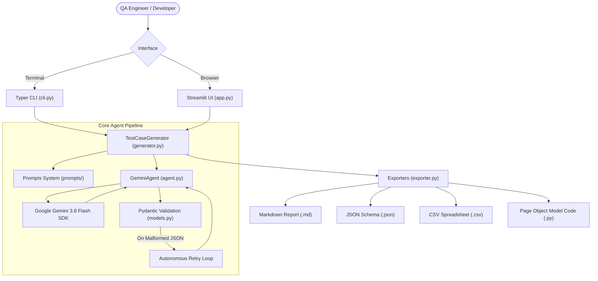

# 🧞 TestCase-Genie

[](https://www.python.org/downloads/)
[](LICENSE)
[](https://docs.pytest.org/)
[](https://ai.google.dev/)

> **AI-Powered QA Test Case & Automation Code Generator for Senior QA Teams.**  
> Transform user stories into comprehensive test scenarios (positive, negative, edge, and boundary cases) and starter **Page Object Model (POM)** automation code in Python with **Playwright** or **Selenium**.

---

## 📸 Demo Preview

```
+-----------------------------------------------------------------------------------+
|  🧞 TestCase-Genie | Streamlit & CLI                                              |
|                                                                                   |
|  [ User Story Input ] ---> [ Google Gemini 3.8 Flash Agent ] ---> [ Structured ]  |
|                                                              |                    |
|  • Positive (Happy Path)  • Negative (Errors)               v                     |
|  • Boundary Value (BVA)   • Concurrency & Idempotency   [ POM Automation Code ]   |
|                                                         • Playwright / Selenium   |
+-----------------------------------------------------------------------------------+
```

*(Demo GIF placeholder: Add `assets/demo.gif` recording showcasing the Streamlit UI and CLI interaction)*

---

## 🌟 What It Does

Writing quality test cases and writing boilerplate automation code from product specifications is time-consuming and often misses subtle edge cases, race conditions, or boundary limits.

**TestCase-Genie** acts as a senior QA architect:
- 📝 **Understands Natural Language Requirements**: Paste any user story, feature specification, or acceptance criteria (via text or `.txt`/`.md` file).
- ⚖️ **Enforces Balanced Coverage**: Automatically generates balanced scenarios:
  - **~40% Positive**: Standard happy-path workflows.
  - **~35% Negative**: Invalid payloads, missing headers, authentication errors, expired sessions.
  - **~25% Edge & Boundary**: Off-by-one thresholds, concurrency, rate-limits, and idempotency guards.
- 🏗️ **Page Object Model (POM) Automation Code**: Generates clean Python automation tests using **Playwright** or **Selenium** with clearly marked `# TODO: Define locator for <element>` placeholders.
- 💾 **Multi-Format Export**: Export test suites instantly to **Markdown (.md)**, **JSON (.json)**, **CSV (.csv)**, and executable **Python test files (.py)**.
- 🛡️ **Defensive Agent Design**: Validates outputs with **Pydantic**, automatically retries malformed JSON, and incorporates exponential backoff on API rate limits.

---

## 🚀 Quick Start

### 1. Prerequisites & Installation

Clone the repository and install dependencies:

```bash
git clone https://github.com/afreenzohra/testcase-genie.git
cd testcase-genie

# Recommended: Create and activate a virtual environment
python -m venv venv
# Windows:
.\venv\Scripts\activate
# Linux/macOS:
source venv/bin/activate

# Install dependencies
pip install -r requirements.txt
```

### 2. Configure Your Gemini API Key

Copy `.env.example` to `.env` and insert your Google Gemini API key:

```bash
cp .env.example .env
```

Edit `.env`:
```ini
GEMINI_API_KEY=your_actual_gemini_api_key_here
GEMINI_MODEL=gemini-3.8-flash
```

> **Security Note:** `.env` is ignored by `.gitignore`. Never commit API keys or secrets to version control.

---

### 3. Run via CLI

TestCase-Genie provides an intuitive **Typer** CLI with rich terminal formatting:

```bash
# Basic generation with Playwright
python src/testcase_genie/cli.py "As a user, I want to reset my password using an email link"

# Specify framework, test count, application domain, and export directory
python src/testcase_genie/cli.py \
  --file examples/01_ecommerce_checkout/user_story.md \
  --framework playwright \
  --count 5 \
  --app-type "E-Commerce" \
  --output-dir ./output \
  --show-code
```

CLI options:
- `--file`, `-f`: Read user story from a `.txt` or `.md` file.
- `--framework`, `-F`: `playwright` (default) or `selenium`.
- `--count`, `-n`: Target scenario count (1 to 30, default 5).
- `--app-type`, `-t`: Domain hint (e.g. `login`, `banking`, `e-commerce`).
- `--output-dir`, `-o`: Directory to save exported `.json`, `.md`, `.csv`, and `.py` files.
- `--show-code`: Print generated automation code directly to the terminal.

---

### 4. Run the Streamlit Web Application

Launch the interactive web UI:

```bash
streamlit run app.py
```

Open `http://localhost:8501` in your browser to:
- Select from built-in sample stories (E-Commerce, Auth with MFA, Banking Transfer).
- Upload `.txt` or `.md` requirements files.
- Inspect categorized test cards with priority badges.
- Download Markdown reports, JSON schemas, CSV sheets, and Python automation code with 1-click.

---

## 📊 Example Input & Output

### Input User Story:
> *"As a retail banking customer, I want to transfer funds from my checking account to an external beneficiary, with real-time balance checks, a $5,000 daily limit, and protection against double-clicking submit."*

### Generated Test Suite Summary Matrix:

| ID | Title | Type | Priority | Expected Outcome |
| :--- | :--- | :---: | :---: | :--- |
| `TC-001` | Successful transfer within balance and daily limit | POSITIVE | CRITICAL | Confirmation modal with Tx ID; balance debited by $500.50 |
| `TC-002` | Transfer rejected when amount exceeds balance | NEGATIVE | HIGH | 'Insufficient funds' alert; transfer aborted |
| `TC-003` | Transfer rejected when daily limit exceeds $5,000 | NEGATIVE | HIGH | 'Daily transfer limit exceeded'; remaining allowance shown |
| `TC-004` | Idempotency key prevents duplicate debit on double click | EDGE | CRITICAL | Exactly ONE debit recorded in transaction ledger |
| `TC-005` | Boundary zero and negative amount rejection | EDGE | MEDIUM | Input field validation blocks amounts <= $0.00 |

### Generated Automation Starter Code (Page Object Model):

```python
import pytest
from playwright.sync_api import Page, expect

class TransferPage:
    """Page Object Model for Banking Fund Transfer."""
    def __init__(self, page: Page):
        self.page = page
        self.source_account = page.locator("select#source-account")  # TODO: Define locator for source account
        self.amount_input = page.locator("input#transfer-amount")   # TODO: Define locator for amount
        self.confirm_btn = page.locator("button#btn-confirm")       # TODO: Define locator for confirm button
        self.tx_modal = page.locator(".modal-tx-success")           # TODO: Define locator for success modal

    def execute_transfer(self, account: str, amount: str):
        self.source_account.select_option(label=account)
        self.amount_input.fill(amount)
        self.confirm_btn.click()

def test_tc_001_successful_fund_transfer(page: Page):
    """TC-001: Successful domestic fund transfer."""
    transfer = TransferPage(page)
    transfer.execute_transfer("Checking #1001", "500.00")
    expect(transfer.tx_modal).to_be_visible()
```

---

## 🏛️ System Architecture



---

## 🧠 Prompt Design Strategy

Prompts are maintained in the `prompts/` directory as decoupled assets:
1. **`prompts/system_prompt.txt`**:
   - **Role Anchoring**: Primes Gemini with the persona of a *Staff QA Architect & Principal Automation Engineer*.
   - **Rigorous Verification**: Mandates boundary conditions, negative workflows, concurrency limits, and security constraints.
2. **`prompts/test_case_generation.txt`**:
   - **JSON-Only Schema**: Mandates strict schema matching `TestCaseSuite` with zero conversational chatter.
   - **Distribution Bias**: Enforces ~40% Positive, ~35% Negative, ~25% Edge & Boundary coverage.
3. **`prompts/code_generation.txt`**:
   - **Page Object Model (POM)**: Isolates page locators in dedicated classes.
   - **`# TODO` Locator Standardization**: Because LLMs cannot inspect proprietary DOMs at runtime, `# TODO: Define locator for <element>` clearly highlights where real selectors must be pasted.

For an in-depth breakdown, see [docs/prompt_engineering.md](docs/prompt_engineering.md).

---

## 🛠️ How I Built This with Antigravity

This project was planned, architected, and built end-to-end with **Antigravity**, Google's advanced agentic coding assistant:
- **Phase-by-Phase Plan**: Created a comprehensive 7-step blueprint before code implementation.
- **Defensive Engineering**: Strictly audited `.env` to guarantee zero secrets leakage into git history.
- **Pydantic Validation & Self-Healing Pipeline**: Engineered an automatic 1-retry repair flow for model JSON outputs.
- **35+ Comprehensive Unit Tests**: Mocked Gemini API calls to ensure zero external dependency during test runs.
- **Clean Git History**: Structured 8 incremental Conventional Commits (`feat:`, `test:`, `docs:`, `ci:`).

---

## ⚠️ Limitations & QA Notices

- **Not Executed Against Live Browsers**: Generated starter automation code has **not** been run against a live browser. Locators are provided as `# TODO` placeholders and must be reviewed, verified, and mapped to your application's actual DOM before test execution.
- **Selector Placeholders**: LLMs do not have live access to your private web application's DOM at runtime. Locators are generated as `# TODO` placeholders that require QA engineers to drop in verified selectors.
- **API Rate Limits**: On free-tier Gemini API keys, high concurrency requests may encounter HTTP 429 rate limits (mitigated via built-in exponential backoff).
- **Dynamic Assertions**: Backend database state assertions require custom database connections or mock fixtures.

---

## 🗺️ Roadmap

- [ ] **TypeScript / Cypress Support**: Add Cypress and Playwright TypeScript generators.
- [ ] **Jira / Xray Integration**: Direct push of generated test cases to Jira via REST API.
- [ ] **Multimodal Screenshot-to-Locator**: Accept UI screenshots alongside user stories to automatically generate real CSS/XPath selectors using Gemini Vision.
- [ ] **BDD / Gherkin Export**: Output `.feature` files formatted for Cucumber/Behave.

---

## 📄 License

Distributed under the **MIT License**. See [`LICENSE`](LICENSE) for details.
