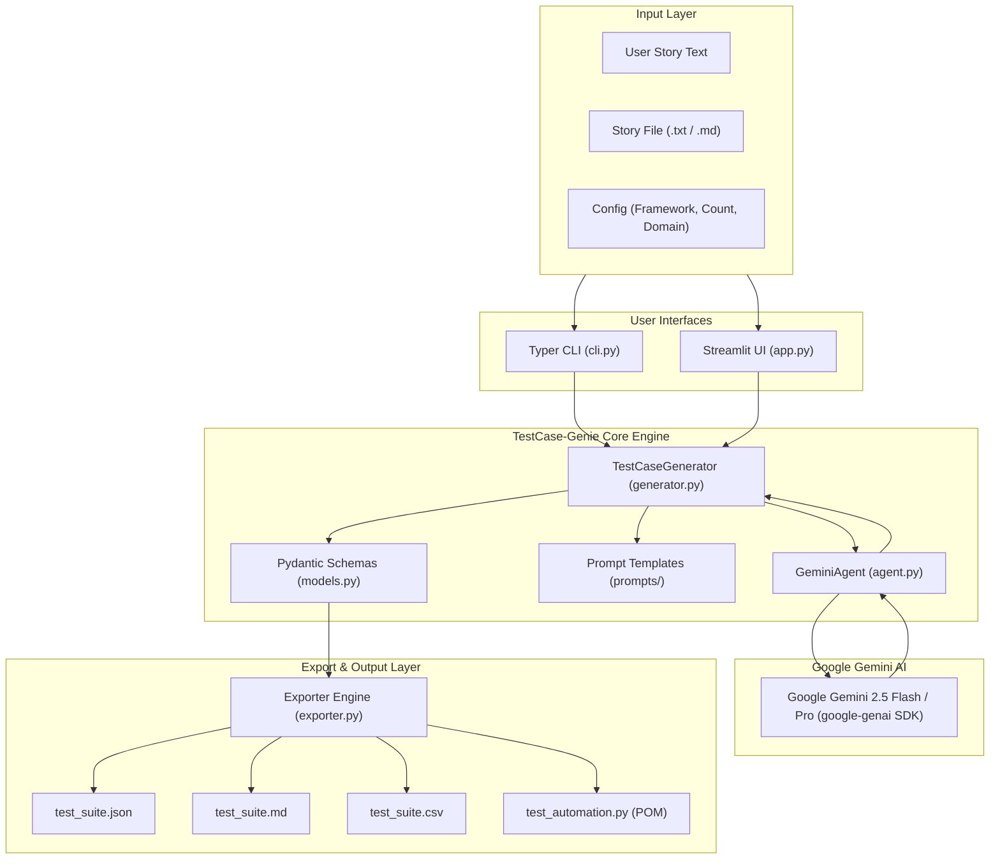
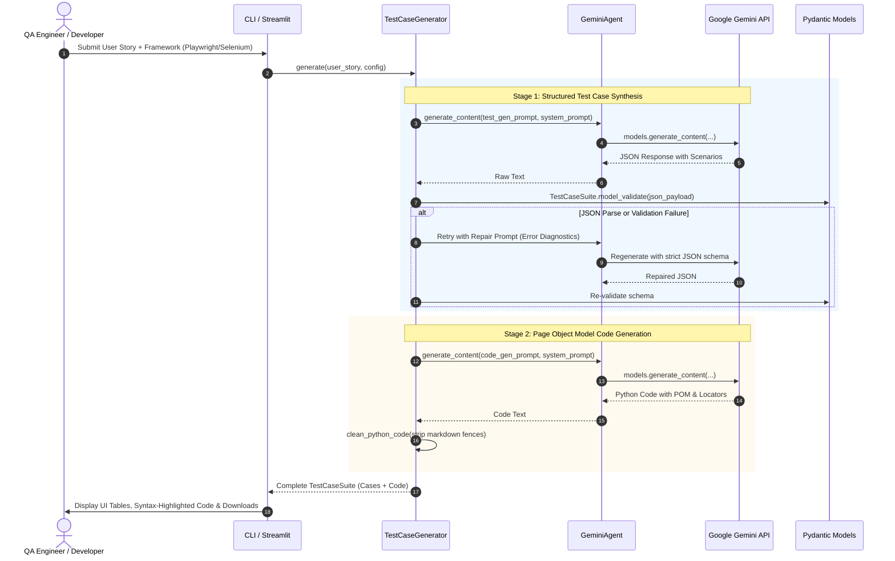

# 🧞 TestCase-Genie: Architecture & System Design

TestCase-Genie is an intelligent test engineering agent designed to bridge the gap between product requirements (User Stories) and automated test execution. It synthesizes structured, ISTQB-aligned test scenarios (positive, negative, edge, and boundary cases) and generates starter automation code adhering to the **Page Object Model (POM)** in Python with **Playwright** or **Selenium**.

---

## 1. High-Level System Architecture

---

## 2. Two-Stage Generation Pipeline

The generation pipeline decouples logical test design from syntax-specific automation code generation:

---

## 3. Resilience and Defensive Design

1. **Deterministic Pydantic Validation**:
   - `TestCase` sanitizes flexible model responses (e.g., coercing multiline string steps into lists of strings, case-insensitively normalizing test types and priority levels).
2. **Autonomous Error Repair**:
   - If the LLM generates slightly malformed JSON or omits a required field, the generator detects the failure and immediately issues a targeted repair prompt providing the exact validation diagnostic.
3. **Rate-Limit & Transient Error Backoff**:
   - Built-in exponential backoff gracefully handles API quotas (HTTP 429) or transient network hiccups without crashing client workflows.
4. **Environment Isolation**:
   - Strict separation of credentials via `.env` and `.gitignore`. No credentials or API tokens are ever logged, printed, or exported.

---

## 4. Automation Code Design: Page Object Model (POM)

Generated code strictly avoids monolithic scripts with fragile inline selectors:
- **Page Classes (`LoginPage`, `CheckoutPage`, `TransferPage`)**: Encapsulate locators and user interactions.
- **`# TODO: Define locator for <element>` Placeholders**: Instantly signal where QA engineers need to plug in their specific production DOM selectors.
- **Standard `pytest` Fixtures**: Setup and teardown browser instances cleanly for CI/CD pipelines.
- **Traceability**: Each generated test function directly corresponds to a test case ID (e.g. `test_tc_001_...`).
